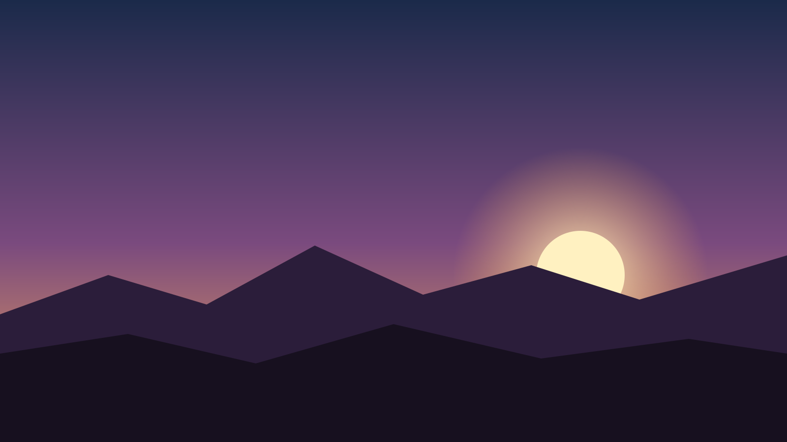

master: title
---
# Blank

A white page and black ink, nothing else

---
master: section
---
# One

---
# Only what the deck writes

- No page numbers
- No fields
- ==Marked== words and *stressed* words in the same ink

---
master: comparison
---
# Two columns

## Left

- One
- Two

## Right

- Three
- Four

---
master: figure
---
# A figure



A caption

---
master: quote
---
> Less, but better

An attribution

---
master: code
---
# Code

```rust
fn main() {}
```

---
master: blank
---
| Key | Value |
| --- | --- |
| a | 1 |

---
master: hero
---
# A photograph


A line over the photograph

---
master: image-left
---
# Picture left


- Words on the right

---
master: image-right
---
# Picture right

- Words on the left


---
master: image-full
---


One line at the bottom

---
master: grid-2
---
# Two pictures


---
master: grid-3
---
# Three pictures


---
master: statement
---
One sentence
